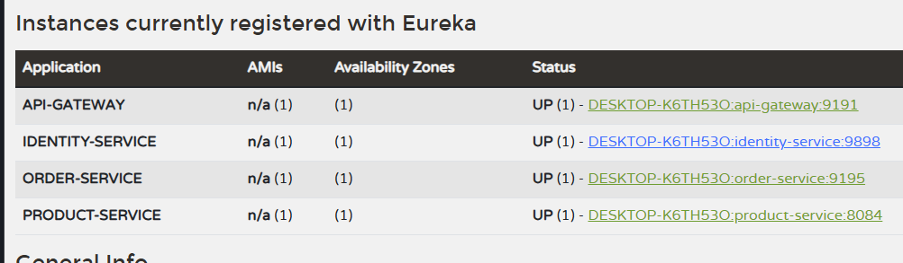

## Introduction

This project is a full-stack application consisting of a client application, an admin page, and a backend built using a microservices architecture.

## Architecture

## Tech stack
- Frontend : React js
- Backend: java, spring boot
- Database: Mysql
- Messaging: Apache Kafka.
- Caching: Redis.
- Infrastructure: Docker, Docker compose.

## Project structure
TODO: Cấu trúc thư mục và vai trò từng module

## Prerequisites
- Java JDK 17
- Inteliji IDEA
- Docker

## Run Project

### Backend

cd backend/env  
``
docker-compose -f docker-compose.yml up -d  ``

Start each microservice manually from IntelliJ IDEA in the following:

1. `service-registry`
2. `api-gateway`
3. `identity-service`
4. `product-service`
5. `order-service`

For each service, select the appropriate Run Configuration and click **Run**.

Wait until the service has started successfully before running the next service.

Check all service run successfully at:  http://localhost:8761/

### Frontend

#### admin  
Open a terminal and navigate to the admin directory:

``
cd /frontend/admin  
``

If this is your first time running the application: ``npm install``  
``
npm start
``  
Open browser and go to: http://localhost:3000  
You can login with account:  
- Username: admin
- Password: 123456

#### client    
Open another terminal and navigate to the client directory:  
``
cd /frontend/client``  
If this is your first time running the application: ``npm install``  
``
npm run dev``  

##  TODO
- The client page doesn't have a login feature yet, so for now , use the admin page to create users for clients.