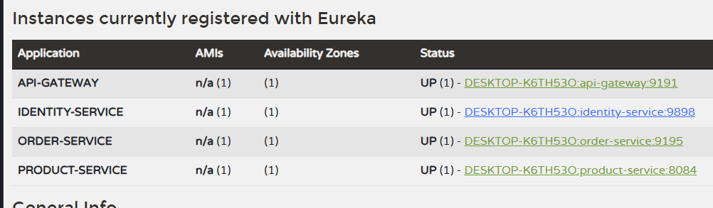

# Microservice E-commerce

## Introduction

This project is a full-stack application consisting of a client application, an admin page, and a backend built using a microservices architecture.


## Architecture overview

```
                 ┌────────────────────┐
                 │  service-registry  │  Eureka :8761 (all services register here)
                 └─────────▲──────────┘
                           │ discovery (lb://SERVICE-NAME)
                           │
React clients ──HTTP──► api-gateway :9191 ──┬──► identity-service :9898  (MySQL user_db)
(:3000 admin,           AuthenticationFilter │
 :5173 client)          RoleBasedAccessFilter├──► product-service  :8084  (MySQL product_db + Redis cart)
                                             │
                                             └──► order-service    :9195  (MySQL order_db)

                 order-service ◄────── Kafka :9193 ──────► product-service
```

| Component        | Responsibility                                                                                       |
| ---------------- | ---------------------------------------------------------------------------------------------------- |
| service-registry | Eureka discovery server                                                                              |
| api-gateway      | Single entry point: routing, JWT check, role check, CORS                                             |
| identity-service | Users, register/login (password and Google), JWT cookie, admin user management, audit log, dashboard |
| product-service  | Products, variants, categories, image upload (Cloudinary), cart (Redis), stock reservation           |
| order-service    | Place orders, outbox, receive stock reservation results                                              |
| common-lib       | Shared DTOs, events, enums, exceptions                                                               |

### Place order flow (Saga with Kafka)

Each service owns its database, so placing an order is a **choreography saga**: local transactions in each service,
linked by Kafka events through a **transactional outbox**, with no central coordinator.

| Step | Service         | Local transaction                                            | Result                                |
| ---- | --------------- | ------------------------------------------------------------ | ------------------------------------- |
| T1   | order-service   | Save order `PENDING` + outbox event `CREATE_ORDER`           | Event to `inventory.command`          |
| T2   | product-service | Insert `processed_orders` + decrease stock (one transaction) | `RESERVED`, or rolled back → `CANCEL` |
| T3   | order-service   | `PENDING` → `CONFIRMED` / `CANCELLED`                        | Frontend polls the order              |

```
Client ─POST /api/v1/order─► order-service: pre-check (Feign) → T1 (order + outbox) → 201 PENDING
OutboxPublisherJob ─► inventory.command ─► product-service: reserve stock (T2)
                                            ─► inventory.result ─► order-service: CONFIRMED / CANCELLED (T3)
PendingOrderTimeoutJob: PENDING > 5 min → CANCELLED + RELEASE_STOCK
```

**Key points**
- **Idempotent checkout:** `Idempotency-Key` header + unique `(user_id, idempotency_key)`; a retry returns the same order.
- **Server prices win:** client prices are only compared; a difference returns `409 PRICE_CHANGED`.
- **Outbox:** the order and its event are saved in one transaction; a job publishes the event, so nothing is lost.
- **Idempotent consumer:** `processed_orders` makes duplicate messages harmless; stock is never reserved twice.
- **Compensation + timeout:** a failed reservation or an order stuck `PENDING` for 5 minutes is cancelled,
  and reserved stock is released.
- **Ordering:** events are keyed by `orderId`, so one order's events stay in order on one partition.
- **Failures:** records that keep failing go to a DLT; if Kafka is down the order is still created and
  completes when Kafka is back.

Details (error codes, topics, DLTs, Kafka down, full sequence): [ORDER_FLOW_DETAILS.md](backend/ORDER_FLOW_DETAILS.md)


## Tech stack
- Frontend: React + Vite.
- Backend: Java 17, Spring Boot, Spring Cloud (Eureka, Gateway, OpenFeign).
- Database: MySQL.
- Messaging: Apache Kafka.
- Caching: Redis.
- Image storage: Cloudinary.
- Infrastructure: Docker, Docker Compose.

## Project structure
```
microservice-ecommerce-clone/
├── frontend/
│   ├── client/                 # React + Vite (shop page)
│   └── admin/                  # React + Vite (admin dashboard)
└── backend/
    ├── env/docker-compose-dev.yml     # MySQL 3307, Redis 6319, Kafka 9193, Kafka UI 8080
    ├── common-lib/            # Shared DTOs, events, enums, exceptions
    ├── service-registry/      # :8761 Eureka
    ├── api-gateway/           # :9191
    ├── identity-service/      # :9898
    ├── product-service/       # :8084
    └── order-service/         # :9195
```

## Prerequisites
- Java JDK 17
- IntelliJ IDEA
- Docker
- Node.js 18+ and npm

## Configuration

### Environment variables

Set these before running (IntelliJ → Run Configuration → **Environment variables**):

| Service          | Variable                                      | Purpose              |
| ---------------- | --------------------------------------------- | -------------------- |
| product-service  | `CLOUDINARY_API_KEY`, `CLOUDINARY_API_SECRET` | Product image upload |
| identity-service | `GOOGLE_CLIENT_SECRET`                        | Google login         |
| frontend/client  | `VITE_GOOGLE_CLIENT_ID`                       | Google login button  |

- **identity-service**: instead of the env var, you can copy
  `backend/identity-service/src/main/resources/application-local.properties.example`
  to `application-local.properties` (gitignored) and fill in the secret.
- **frontend/client**: copy `frontend/client/.env.example` to `.env.local` and set `VITE_GOOGLE_CLIENT_ID`
  (same value as `GOOGLE_CLIENT_ID` of identity-service).

Never commit real secrets to the repository.

### Infrastructure

Started by `backend/env/docker-compose-dev.yml`:

| Component | Address               | Notes                                                                                                |
| --------- | --------------------- | ---------------------------------------------------------------------------------------------------- |
| MySQL     | `localhost:3307`      | user `root` / `123456`. `user_db`, `product_db`, `order_db` are created by `env/mysql/init/init.sql` |
| Redis     | `localhost:6319`      | Cart storage                                                                                         |
| Kafka     | `localhost:9193`      | Order saga events                                                                                    |
| Kafka UI  | http://localhost:8080 | View topics and messages                                                                             |

## Run Project

### Backend

Start the infrastructure (MySQL, Redis, Kafka):

```bash
cd backend/env
docker-compose -f docker-compose-dev.yml up -d
```

Start each microservice manually from IntelliJ IDEA in the following order:

1. `service-registry`
2. `api-gateway`
3. `identity-service`
4. `product-service`
5. `order-service`

For each service, select the appropriate Run Configuration and click **Run**.

Wait until the service has started successfully before running the next service.

Check that all services are registered at: http://localhost:8761/




### Frontend

#### admin  
Open a terminal and run:

```bash
cd frontend/admin
npm install   # first time only
npm start
```

Open browser and go to: http://localhost:3000  
You can login with account:  
- Username: admin
- Password: 123456

#### client    
Open another terminal and run:

```bash
cd frontend/client
npm install   # first time only
npm run dev
```

Open browser and go to: http://localhost:5173
