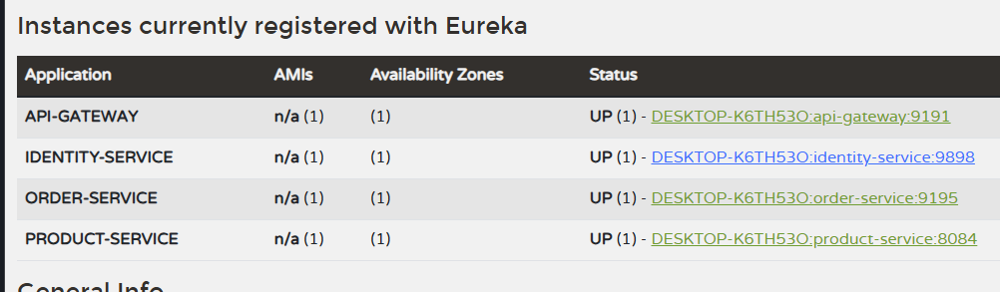

## Introduction

This project is a full-stack application consisting of a client application, an admin page, and a backend built using a microservices architecture.


## Architecture overview

```
                 ┌────────────────────┐
                 │  service-registry  │  Eureka :8761 (all services register here)
                 └─────────▲──────────┘
                           │ discovery (lb://SERVICE-NAME)
                           │
React clients ──HTTP──► api-gateway :9191 ──┬──► identity-service :9898  (MySQL user_db)
(:3000 admin,           AuthenticationFilter │
 :5173 client)          RoleBasedAccessFilter├──► product-service  :8084  (MySQL + Redis cart)
                                             │
                                             └──► order-service    :9195  (MySQL order_db)

                 order-service ◄────── Kafka :9193 ──────► product-service
                                           │
                                           └──────────────► email-service :8086 (currently not run)
										   
```

| Component         | Responsibility |
|------------------|-----------------|
| service-registry | Eureka discovery server |
| api-gateway      | Single entry point: routing, JWT check, role check, CORS |
| identity-service | Users, register/login (password and Google), JWT cookie, admin user management, audit log, dashboard |
| product-service  | Products, variants, categories, image upload (Cloudinary), cart (Redis), stock reservation |
| order-service    | Place orders, outbox, receive stock reservation results |
| common-lib       | Shared DTOs, events, enums, exceptions  |

### Place order flow (Saga with Kafka)

Each service owns its database, so placing an order cannot use one shared transaction.
It is a **choreography saga**: the work is split into local transactions in each service,
linked by Kafka events, with no central coordinator.

| Step | Service | Local transaction | Result |
|---|---|---|---|
| T1 | order-service | Save order `PENDING` + outbox event | Event to `create_order_topic` |
| T2 | product-service | Decrease stock + record `processed_orders` | `RESERVED`, or rolled back → `CANCEL` |
| T3 | order-service | `PENDING` → `CONFIRMED` / `CANCELLED` | End |

**Compensation:** if T2 fails (out of stock), T1 is already committed and cannot be rolled back,
so order-service compensates by setting the order to `CANCELLED`.

Two topics are used, one per direction:

| Topic (config key) | Name | Producer → Consumer | Payload |
|---|---|---|---|
| `spring.kafka.create-order-topic.name` | `create_order_topic` | order-service → product-service | `OrderMessageEvent` (orderId, items, userId, email…) |
| `spring.kafka.update-order-topic.name` | `update_order_topic` | product-service → order-service | `OrderMessageEvent` (orderId, status = `RESERVED` / `CANCEL`) |

Topic names are always read from config, never hard-coded.

```
Client ──POST /api/v1/order──► order-service / OrderController
                                  │ 1. Feign → product-service: pre-check stock and price 
                                  │ 2. One DB transaction (T1):
                                  │      - save Order (PENDING)
                                  │      - save OutboxEvent (NEW)
                                  ▼
◄── 3. 201 Created (order PENDING)

OutboxPublisherJob (every 1s, batch 500)
   │ 4. read NEW events → send to Kafka, wait for broker ACK → mark SENT
   ▼
create_order_topic
   ▼
product-service / OrderConsumer (T2)
   │ 5. skip if order already in processed_orders (duplicate message)
   │ 6. decrease stock with a conditional UPDATE (stock >= quantity)
   │ 7. send RESERVED or CANCEL → set published = true
   ▼
update_order_topic
   ▼
order-service / InventoryConsumer (T3)
     8. only if order is PENDING: RESERVED → CONFIRMED, CANCEL → CANCELLED
```

Details:  [OrderConsumer_ErrorHandling.md](backend/OrderConsumer_ErrorHandling.md)

## Tech stack
- Frontend : React js
- Backend: java, spring boot
- Database: Mysql
- Messaging: Apache Kafka.
- Caching: Redis.
- Infrastructure: Docker, Docker compose.

## Project structure
```
microservice-ecommerce-clone/
├── frontend/
│   ├── client/                 # React + Vite (trang mua hàng)
│   │   
│   └── admin/                  # React + Vite (trang quản trị)
└── backend/
    ├── env/docker-compose-dev.yml     # MySQL 3307, Redis 6319, Kafka 9193, Kafka UI 8080
    ├── common-lib/            # DTO, event, enum, exception dùng chung
    ├── service-registry/      # :8761 Eureka
    ├── api-gateway/           # :9191
    ├── identity-service/      # :9898
    ├── product-service/       # :8084
    ├── order-service/         # :9195
```

## Prerequisites
- Java JDK 17
- Inteliji IDEA
- Docker

## Run Project

### Backend

cd backend/env  
``
docker-compose -f docker-compose-dev.yml up -d  ``


Start each microservice manually from IntelliJ IDEA in the following:

1. `service-registry`
2. `api-gateway`
3. `identity-service`
4. `product-service`
5. `order-service`

For each service, select the appropriate Run Configuration and click **Run**.

Wait until the service has started successfully before running the next service.

Check all service run successfully at:  http://localhost:8761/




### Frontend

#### admin  
Open a terminal and navigate to the admin directory:

``
cd /frontend/admin  
``

If this is your first time running the application: ``npm install``  
``
npm start
``  
Open browser and go to: http://localhost:3000  
You can login with account:  
- Username: admin
- Password: 123456

#### client    
Open another terminal and navigate to the client directory:  
``
cd /frontend/client``  
If this is your first time running the application: ``npm install``  
``
npm run dev``  
